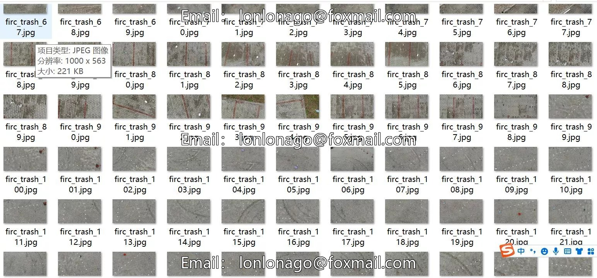
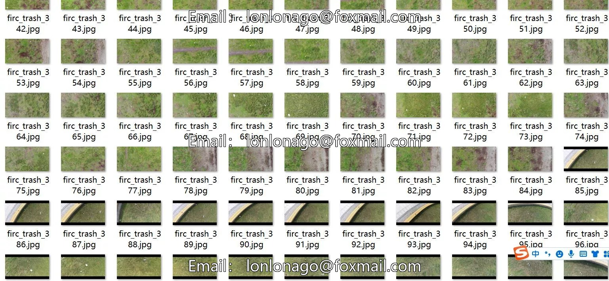
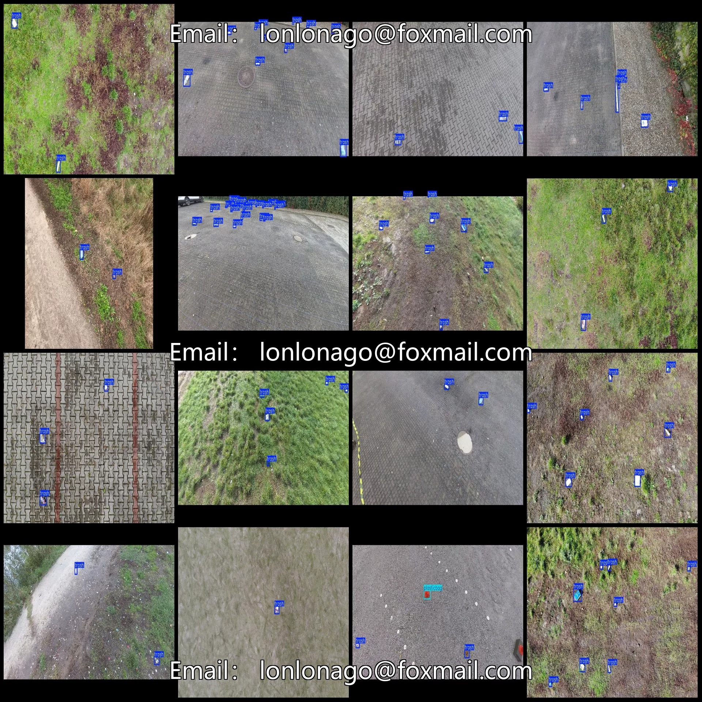

# Drone-viewed Park Street Waste Detection Dataset VOC+YOLO format: 771 images

## Body

Drone-Viewed Park Street Waste Detection Dataset - VOC+YOLO Format - 771 Images in 2 Categories
Warm Reminder: Due to the dataset's replicability, please confirm compliance with requirements before purchasing.
Dataset Format: Pascal VOC format + YOLO format (txt file without split path, only containing jpg images and corresponding VOC format xml files and yolo format txt files)
Number of Images (Total jpg files): 771
Number of Annotations (Total xml files): 771
Number of Annotations (Total txt files): 771
Number of Annotation Categories: 2
Repository: firc-dataset

Annotation Category Names: ["plasticbag", "trash"]
Number of Boxes per Category:
- plasticbag = 89
- trash = 3616
Total Boxes = 3705
Image Resolution: 1000x563
Drone: DJI MAVIC 3
Collection Height: 5-10m
Collection Angle: 90°
Labeling Tool: labelImg
Annotation Rules: Draw a rectangle around the category.
Important Note: No training, validation, or test splits are required; you will need to manually divide your data accordingly.

Special : This dataset does not guarantee the accuracy of the trained models or weight files.

## Images

## Payment

Here is a pay link on Stripe ( https://buy.stripe.com/3cs8yP7sY87d0vu9AB ). Please contact me lonlonago@foxmail.com after funding $89, and I will send you a complete data files , thank you!

